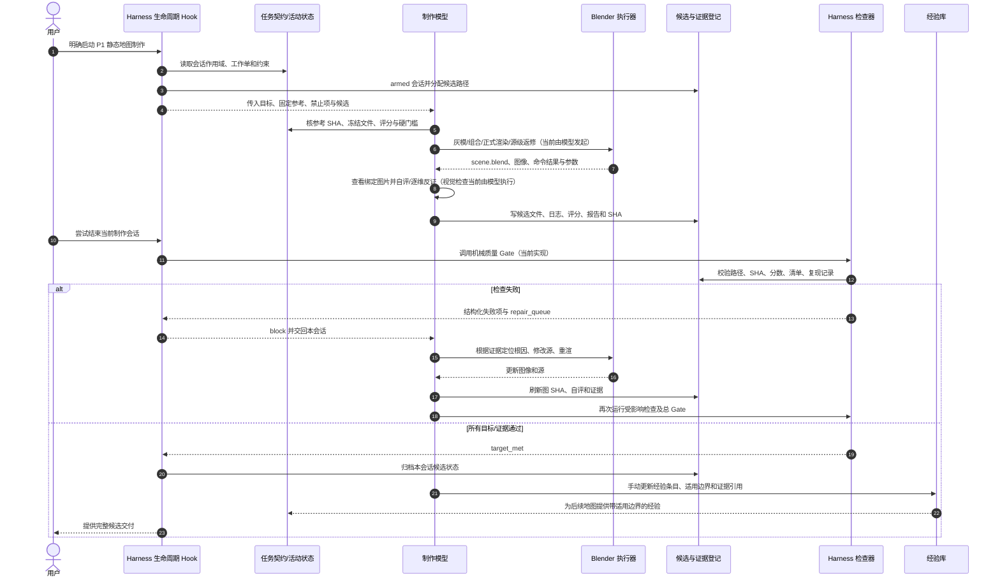

# P1 静态美术 Harness：架构、现状与落地路线

日期：2026-11-02  
范围：P1 秋日静态地图。当前画面约束、评分和“不需要其他模型独立终审”沿用 v3 用户决策；本文解释 Harness 作为控制/验证闭环的角色。

## 1. Harness 是什么

**Harness 不是制作模型，也不是一段评分脚本。** 它是围绕制作模型的任务控制系统：给它明确的输入和约束，调用制作工具，收集版本化产物，运行检查，把失败转成有证据的修复项，再推动同一制作模型继续，直到达标后交付并沉淀可复用经验。

对当前 P1：

- **制作模型**负责理解美术目标、打开图片、判断画面、编辑 Blender、渲染和修复。
- **Blender**负责提供可编辑场景和图像产出。
- **P1 Art Harness**负责把任务契约、候选状态、工具调用记录、检查、反馈、完成状态和经验记录串起来。
- **质量 Gate**只是 Harness 中的一个机械检查器。它不等于整个 Harness，也不会自动理解画面或替模型修 Blender。

当前 Harness 的重要目标仍是：固定 P1 参考；静态图零植被；左侧/右侧植物原占位用有用途的大型设备替代；总分至少 85、六维各至少 3；同一制作模型自评并逐维反证；不要求其他模型独立终审。

## 2. Harness 七层架构与真实实现状态

| Harness 层 | 应负责什么 | 当前已有 | 当前缺口/边界 |
|---|---|---|---|
| 1. 任务契约 `Spec` | 锁定目标、固定参考、禁止项、评分、硬门槛、交付文件 | `AGENTS.md`、P1 美术标准、工作流、工作单和 `ACTIVE_STATIC_ART.json` 分别承载这些规则 | 规则散落多份；尚无单个机器可读 `P1_HARNESS_SPEC.json` 自动校验全部来源和版本 |
| 2. 生命周期控制 `Controller` | 限定项目/会话，启动任务，记录候选和每次门禁状态 | `.codex/hooks.json` + `static_map_quality_hook.py` 对明确启动的 P1 会话 armed；Stop 时调用 Gate，失败会 block 并给出反馈 | 仅是项目 Hook；依赖 Codex 信任及会话 armed；它不会自己创建场景、运行修复任务或无条件保证任务继续 |
| 3. 制作执行器 `Executor` | 让模型按工作单调用 Blender，记录命令、退出码、耗时 | 制作模型可以调用本机 Blender；工作单要求逐批留日志 | 没有统一 runner 封装 Blender 命令/环境、重试、超时和 run ID；制作模型仍自行组织执行 |
| 4. 制品登记 `Artifact Registry` | 每候选版本隔离，记录源/渲染/参考/报告 SHA 与父版本 | `ACTIVE_STATIC_ART.json`、`DELIVERY.json`、`GATE_REPORT.json` 和独立候选目录约定 | SHA 和 manifest 由制作模型填写；没有统一 preflight 防止遗漏冻结对象或候选重用 |
| 5. 检查器 `Validators` | 分别运行静态文件/参数检查、Blender 复现、零植被检查和视觉检查 | `tools/static_map_quality_gate.py` 核路径、SHA、评分算术、清单和复现声明；制作模型看图自评 | Gate 不运行 Blender、不扫描场景对象、不看图。零植被对象盘点和画面视觉评分目前仍由制作模型人工完成 |
| 6. 失败反馈/修复控制 `Repair Loop` | 失败以规则 ID、实测、证据、修法反馈给同一制作模型；更新源、重跑受影响检查 | Gate 报 failure/repair_queue；Stop Hook 将结果返回当前会话；工作流规定按根因修改并循环 | 没有统一的检查结果 schema 覆盖所有检查器；没有自动根因分类或 Blender 自动修复；模型仍要实际判断和执行 |
| 7. 学习沉淀 `Learning` | 记录失败原因、有效修法、适用条件和复测状态，避免重复踩坑 | `planning/execution/LESSONS.md`、`knowledge/REUSABLE_MAP_ART_PIPELINE.md` 有状态标签和经验边界 | 手工总结，无自动去重、来源 SHA/候选 ID 强制绑定或跨轮效果统计；未经复测的经验必须继续标 `proposed/observed` |

## 3. 当前系统实际如何工作

当前准确描述是 **“Harness 骨架已落地，执行和视觉诊断仍由模型驱动”**，不是“全自动美术 Harness”。实际路径如下：

1. 用户明确启动 P1 制作，项目 `UserPromptSubmit` Hook 检查路径/作用域，为本会话写入状态并选一个候选路径。
2. 制作模型读取项目规则和工作单，检查参考与候选，自己调用 Blender 做灰模、组合、正式图和返修。
3. 制作模型写入场景、图像、REVIEW、DELIVERY 和 GATE 报告，报告中填写自评分数、逐维反证、检查证据和 SHA。
4. 用户尝试结束当前制作会话时，项目 Stop Hook 调用 Python Gate。
5. Gate 若发现缺字段、SHA、分数、组合项、硬门槛或复现问题，就 block 并将失败原因送回**同一个制作模型会话**。
6. 制作模型按失败项修改 Blender 源、重渲、更新证据后再次运行检查；Gate 通过后归档会话状态。
7. 本轮有效经验由模型/维护者更新到 Lessons 和跨地图流程文档；没有复测的内容保留为 `proposed/observed`。

因此，自动化目前主要覆盖**会话作用域、机械验收和失败回传**。视觉判断、Blender 运行、根因选择、实际修改和知识提炼仍是模型的责任。用户停止会话或 Hook 未受信任/未 armed 时，项目无法保证继续执行。

## 4. Harness 时序图



**图中的“Blender 执行器”和“Registry”目前主要是流程角色/文件约定，不是独立常驻服务。** 当前 Hook 只负责当前会话的启动/结束反馈；并没有后台队列或另一个 AI 自动替制作模型改图。

## 5. 统一检查结果契约（设计目标）

所有检查器逐步统一输出以下形式，供 Harness 汇总。该 JSON 是**接口设计**，不表示现有 Gate 已完整实现所有字段：

```json
{
  "run_id": "p1-vNN-iteration-03",
  "candidate_id": "vNN",
  "artifact_sha256": {
    "scene": "...",
    "render": "...",
    "reference": "..."
  },
  "rule_id": "P1-ZERO-VEGETATION-01",
  "profile": "scene_inventory | visual_p1 | reproducibility | mechanical_gate",
  "status": "pass | fail | not_run | not_applicable",
  "observed": "实际发现",
  "expected": "锁定标准",
  "evidence": ["候选内相对路径或可见位置"],
  "repair": {
    "cause_hypothesis": "需核实的根因",
    "action": "源级修复动作",
    "verification": "修复后重跑的检查"
  }
}
```

- `pass` 只能表示该条规则按证据通过；`fail` 必须带明确定位和 repair。
- `not_run` 和 `not_applicable` 不得伪装成 `pass`；未运行的视觉审核不能由机械 gate 补齐。
- 修复后建立新 run 记录并关联父 run；更新渲染 SHA 后，旧图上的自评和检查不再有效。
- P1 的 `no_vegetation` 需同时关联源场景对象/集合/实例/材质贴图清点和最终图全画面检查。名称扫描只是辅助，不能证明画面绝无植物。

## 6. 下一步落地优先级

| 优先级 | Harness 增量 | 具体行为 | 可验证结果 |
|---|---|---|---|
| P0 | 单一任务 Spec | 新增机器可读 spec，汇总固定参考 SHA、零植被条款、评分权重、检查 ID、必需文件、禁止覆盖和退出条件；文档只引用 Spec 的规则 ID | 开工 preflight 能检查各权威文件版本/哈希和任务范围；不再从多处猜约束 |
| P1 | 静态场景 inventory 检查器 | 通过 Blender 后台 Python 读取 `.blend`，输出 object/collection/instance/材质图片清单；标记疑似植物引用供模型逐条确认 | 生成 `scene_inventory.json`，所有命中都有 remove/allowed 决定；报告零未处理命中。最终图片仍要模型目视 |
| P1 | Preflight + Artifact Binder | 检查参考存在/SHA、候选未占用、冻结文件未变、必需目录和已记录命令；自动生成 binding 模板 | 缺文件或 SHA 不符时在正式渲染前失败；减少手工漏项和错绑 |
| P2 | Blender Run Wrapper | 读取候选中明确声明的 Blender 命令/版本，记录 stdout、stderr、exit code、耗时、源 SHA、输出图尺寸/SHA；不硬编码某一版 Blender 路径 | 任意一轮可审计复跑；运行失败归因清楚，不让旧图误当新图 |
| P2 | 检查汇总/Repair Adapter | 把 scene inventory、复现、质量 gate 和制作模型视觉自评合并为统一 failure list；每条指向对象/区域、根因假设和需重跑项 | 一次返回可执行修复队列；只重跑受改动影响的检查，但最终交付仍全量 gate |
| P3 | 经验回写流程 | 从 run 日志生成 Lessons 候选条目，强制写适用范围、失败反例、候选 ID/SHA 与状态；人工/模型复核后才入知识库 | 经验可追溯、未复测不升为 `reusable`，避免把一次成功当通用规则 |

不把“自动画好”设成 Harness 承诺：模型仍需执行美术判断和 Blender 修改。Harness 先保证**约束一致、产物可追溯、失败不静默放行、返修有方向、经验可复用**。在 P0–P2 落地并记录实际阶段耗时之前，不承诺具体节时百分比。

## 7. 与其他工具的关系

- `tools/static_map_quality_gate.py`：当前机械验收器，不是 Harness 本体。
- `.codex/hooks/static_map_quality_hook.py`：当前项目/会话生命周期接线，失败时回传；不会编辑场景。
- Blender：当前模型驱动的制作工具；未来可由 Runner 统一包装 CLI，但不让 Runner隐式改用户全局 Blender 配置。
- `tools/art_harness.py`、47 项/Q01–Q09：属于暂停的完整游戏流程，不适用于当前 P1 静态美术 Harness。
- `knowledge/REUSABLE_MAP_ART_PIPELINE.md`：沉淀跨地图方法；P1 具体色板、造型、无植被规则不自动复制为其他地图答案。
