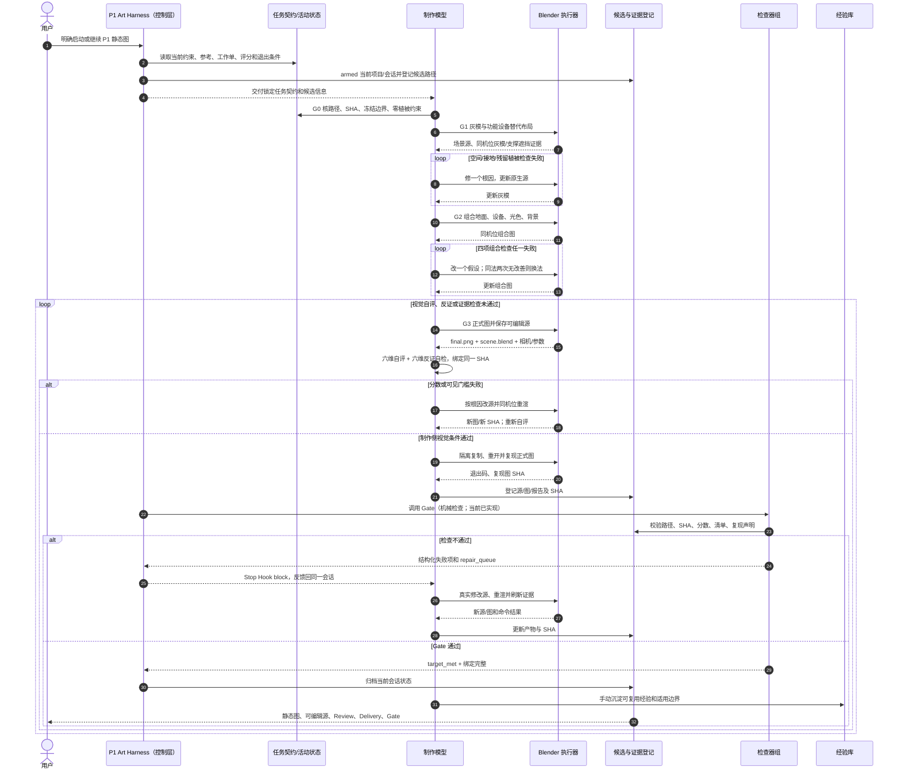

# P1 静态地图开发链路与 Harness 架构审查

审查/修订日期：2026-11-01（v3）  
范围：静态地图制作、返修、验收、知识库与项目级质量 hook。**本次只修流程/工具契约与知识内容；没有修改候选 `.blend` 或渲染图。**

> **Harness 说明：** 本文上一版主要画了制作人、Blender 和 Gate 的交接，确实没有把外层 Harness 控制器画出来。现在明确区分：P1 Art Harness = 任务契约 + 项目/会话 Hook + 制作模型/Blender 执行 + 候选/证据登记 + 多类检查器 + 失败反馈与返修循环 + 知识回写；`static_map_quality_gate.py` 只是其中的机械检查器。分层和实现状态详见 [P1 Art Harness 架构](P1_ART_HARNESS_ARCHITECTURE_20261102.md)。

## 本轮结论

旧链路不能一致执行：美术指导和部分入口接受低密度植物，工作单仍要求修树/草；评分与 gate 有植被维度/硬门槛；hook 又要求独立 reviewer。用户最新方向同时否定了这些设置。现在所有现行入口统一为：

1. **P1 静态地图中完全无植被**。移除树、叶、草、花、灌木、苔藓、藤蔓、杂草、盆栽、花池、裸土和植物贴图/纹样。用左侧维护柜/设备组、右侧封闭圆筒过滤/储液设备接替原图的主体体量。其他箱柜只在说明场景功能、并且有支撑/接口时加入。
2. **没有其他模型独立终审**。同一制作模型承担视觉自评、逐维反证、实际返修、复现和报告；项目 gate 只做机械验证。用户以后要求 Codex 看图时属于额外检查，不是外部模型必须的关卡。
3. **评分目标明确是无植被改编质量**。固定 P1 原图仍用于构图、空间、石材、暖光、设施和远景层次；植物作为原图已观察事实，不作为当前制作项，不因其移除本身扣分，不宣称已复刻植物。
4. 保留 85/100、每维至少 3/4、四项组合检查、八项硬门槛和 Blender 隔离复现。低分修源重渲，直到通过；不因循环次数或缺少 reviewer 停止。

## 优先级问题与修复结果

| 优先级 | 问题 | 风险 | 现行修复 | 验收证据 |
|---|---|---|---|---|
| P0 | 参考图有植被，用户要求完全去除，旧流程仍以树草为目标 | 目标互斥，导致无限返修或伪称达标 | 定义无植被改编目标；两处主植物体量替换为功能设备；评分不扣除按要求移除植物 | 零植被硬门槛 + REVIEW 中对象/贴图检查和全图目视记录 |
| P0 | gate 要求其他模型独立终审 | 任务可能因无 reviewer 而被锁住；字段不能证明真实独立 | v3 移除 `independent_review` 和 reviewer 身份门槛；改为制作模型自评 + 同模型六维反证自检 | 当前 gate 只收 `producer_review`、`producer_countercheck`、组合/硬门槛和 SHA |
| P0 | 自评分可能乐观，且 gate 看不到画面 | 分数高但画面反例漏报 | 自评后逐维提出最强反例，写保留/下调理由与最终分；所有描述绑定最终图 SHA；低分继续修源 | 六维 countercheck 与最终自评分一致；图片 SHA 未变 |
| P1 | 灰模、工作单、标准、hook、知识库存在多个版本口径 | 模型读到旧文档后做错方向 | 权威源固定为 AGENTS、START_HERE、工作流、美术标准、hook/gate、活动工作单；旧文档顶部标历史 | 入口六件套与 v3 字段一致 |
| P1 | gate 的能力可能被误解成自动视觉审核 | 机械通过被当作画质通过 | 文档明确 gate 不看图、不运行 Blender、不自动修图；它只核路径/SHA/数字/结构/复现记录 | 自评有图片可见证据，隔离复现另有日志 |
| P1 | 过程图、遮罩和诊断图无条件增加 | 渲染与归档时间增加，磁盘膨胀 | 必需交付收敛到源、最终图、profile、REVIEW、DELIVERY、GATE；其余按诊断需要 | 文件清单与实际诊断用途相符 |
| P2 | 多模型交接与重复评审耗时、实际收益有限 | 低分问题仍落回制作方，等待增加时长 | 常态改为一个连续制作闭环；只有用户主动要求时由 Codex 额外复核 | 执行日志记录 G0–G3 用时和渲染重试，不承诺未经测量的节时比例 |

## 当前链路（唯一执行顺序）

### G0 输入锁定

读取项目规则、活动状态/工作单、流程、美术标准、v3 gate 契约；验证固定参考 SHA，核对冻结证据；选择未占用候选目录。旧文件只按明确历史用途读取，不从 mtime 猜“最新版”。

### G1 空间灰模

固定镜头前先确认主石板、台阶/栏杆、平台高差、近中远关系、功能设备替代区、设备支撑/连接和场景入口。清理植物对象/实例/贴图；左侧维护设备组和右侧封闭圆筒设备均明确用途、底座、检修面和投影。先查悬空、穿插、遮挡，后锁机位。

### G2 代表性组合

在同一相机和画幅下组合地面、结构设备、光色和背景。用全图缩略、50% 缩图和必要局部检查 `floor`、`structures`、`lighting`、`background` 四项。一次只改一个主要假设；同一方法连续两次无改善，记录失败并改方法继续。

### G3 完整画面与生产者自我修复

先出完整图和可编辑源；制作模型查看当前 SHA 的图，六维评分后再逐维寻找最强扣分反例，必要时下调分数。达不到 85 分、逐维 3 分、组合/硬门槛或零植被要求时，写源级修复动作、改 Blender、同机位重渲、刷新 SHA 和自评。完成后隔离复制重开 Blender 并复现，更新交付文件，运行 gate。所有条件满足才标 `target_met`。

Hook 返回 `block` 时，仍由同一制作模型读取具体失败原因并持续返修。不能因普通低分、需要更多时间或不存在独立 reviewer 而结束。真实外部依赖且替代方案耗尽才可提交有证据的 `blocked_external`，它表示未完成。

## 时间和质量控制

- 不预设“会缩短 X%”。当前没有完整 G0–G3 的可靠墙钟基线；可确认的结构性减少是独立终审交接/等待从必需步骤移除，制作之外的人工评审次数由 1 降到 0；这不等于总时长保证减少某百分比。
- 旧流程 6 项必交保持收敛：`.blend`、final render、profile、REVIEW、DELIVERY、GATE。组合证据合并，遮罩/DOF/细节板按诊断选用，减少必需整理项。
- 每个假设记录实际耗时和失败/成功次数。质量损失通过同模型反证、严格可见证据、全图与局部对照、同源复现、哈希绑定和自动返修钩子控制；脚本无法担保“主观审美绝对正确”。
- 15 GiB 项目容量上限、12 GiB 预警保留；只清理 dry-run 许可的可重建缓存，不删除冻结候选或唯一证据。

## P1 Art Harness 执行时序图

当前实现边界：Hook 负责项目/会话作用域与 Stop 反馈；Gate 只做机械检查；Blender 命令、画面自评、根因分析、返修和知识回写仍由制作模型执行。该 Harness 不是后台自动修图服务，也不要求其他模型独立终审。完整实现状态和后续构建路线见 `P1_ART_HARNESS_ARCHITECTURE_20261102.md`。

## 文件权威级别

| 文件 | 作用 |
|---|---|
| `AGENTS.md` | 项目硬约束和范围 |
| `START_HERE.md` | 最小开工入口和必读顺序 |
| `ACTIVE_STATIC_ART.json` | 活动图、SHA、状态和下一工作单 |
| `P1_WORKORDER_20261101_NEXT.md` | 当前单轮对象级执行任务 |
| `STATIC_MAP_WORKFLOW_20261028.md` | G0–G3 制作/返修/交付规范 |
| `P1_T084_ART_DIRECTION_STANDARD_20261028.md` | 固定参考、锚点、评分和画面硬门槛 |
| `CODEX_STATIC_MAP_QUALITY_HOOK_20261029.md` + Python gate | 项目 hook 边界与 v3 报告契约 |
| 历史评审/版本方案 | 追溯旧证据，不用于当前执行 |

当前 V27 仍为未验证图，不是达标案例；本轮只更新流程/门禁/知识库，没有产出新的地图图像。
